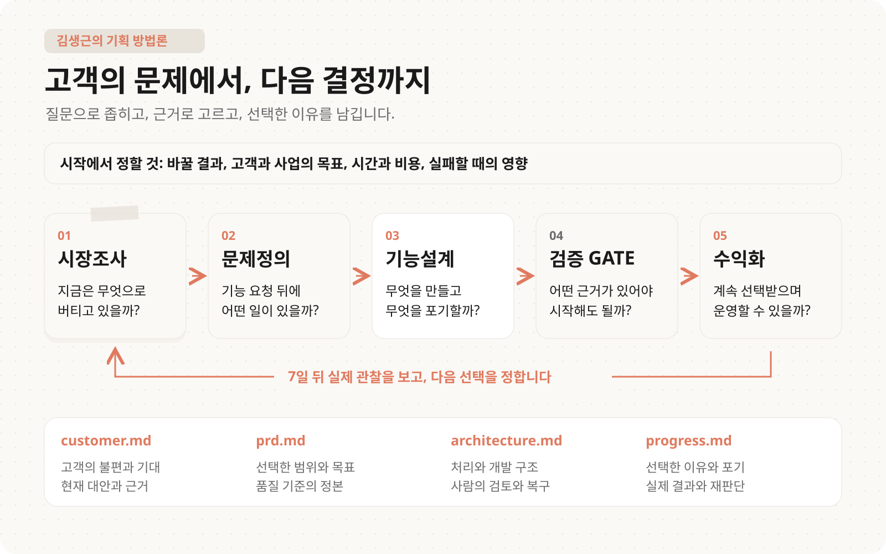
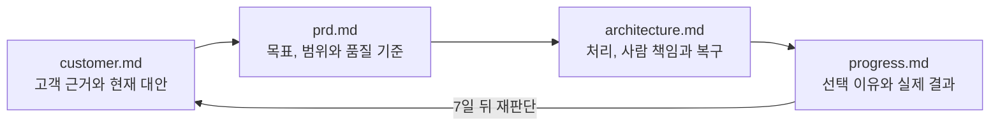

# AI를 쓰는 기획자의 판단법

  

고객의 문제에서 시작해 무엇을 만들고, 무엇을 멈추고, 어떤 근거로 선택을 바꿀지 정합니다. 김생근이 실제 업무에서 사용한 판단 방식과 독립 연습 입력을 엮은 한국어 실무 키트입니다.

핸드북은 28쪽, 메타프롬프트는 입력 양식과 채운 실행예 10쌍입니다. 세 경험 사례와 별개의 연습 입력을 구분했습니다. 영상 현지화 예시는 인터뷰, 실제 시험, 코드 구현 전의 연습 자료이며 고객 증거나 실행 성과를 대신하지 않습니다.

[웹에서 읽기](https://habix.ai/playbook/ai-planning) | [PDF 받기](https://habix.ai/assets/ai-planning/handbook.pdf) | [핸드북 원문](manuscript/README.md) | [전체 키트 ZIP](https://github.com/kimsanguine/ai-planning-playbook/archive/refs/heads/main.zip)



## Q. 오늘 내 과제로 어떻게 시작하나요?

텍스트 편집기와 공개해도 되는 업무 메모면 충분합니다. AI 계정, 유료 모델, API 키, 개발 도구 없이 수동으로 끝낼 수 있습니다.

1. 위 ZIP을 내려받아 압축을 풀거나 이 저장소를 복제합니다.
2. 새 프로젝트라면 [templates](templates)의 `customer.md`, `prd.md`, `architecture.md`, `progress.md`를 자기 프로젝트 폴더에 복사합니다. 기존 파일이 있으면 먼저 읽고 필요한 절만 병합하세요. 회사 양식이 필수라면 그대로 유지하고 네 역할이 있는 위치를 연결합니다.
3. 오늘 막힌 선택 하나를 정합니다. 예를 들면 “작업자가 고른 한 구간의 재시도를 허용할까?”입니다. `progress.md`에 질문, owner, 오늘 날짜, 7일 뒤 review를 적습니다.
4. [핸드북 2쪽](https://habix.ai/playbook/ai-planning/diagnose-the-block)과 [5쪽](https://habix.ai/playbook/ai-planning/four-files)을 읽고 필요한 질문 한두 개에 답합니다. 수동으로 하려면 [24쪽의 최소 경로](https://habix.ai/playbook/ai-planning/own-work)를 따라가세요.
5. 네 파일을 저장하고 닫았다 다시 엽니다. 같은 자료 ID, Q-ID, DEC-ID로 선택과 이유가 연결되는지 [결정 체크리스트](docs/decision-checklist.md)로 확인합니다.

자료가 없으면 미확인과 확인할 질문을 적습니다. AI가 자료 밖 고객 발언이나 수치를 만들었다면 버리고, 사람이 선택에 영향을 준 이유를 기록합니다. 기존 실제 결과와 결정 이력을 예시로 덮어쓰지 않습니다.

## Q. 무엇을 어느 파일에 남기나요?



| 파일 | 저장할 내용 | 사람이 확인할 것 |
| --- | --- | --- |
| [customer.md](templates/customer.md) | 최근 사건, 현재 대안, 출처와 가설 | 자료가 실제로 말한 것과 모르는 것 |
| [prd.md](templates/prd.md) | 목표, 포함과 제외, 품질 기준 | 이번에 바꿀 사용자 결과와 감수할 손실 |
| [architecture.md](templates/architecture.md) | 입력과 처리, 코드와 사람 책임, 복구 | 어디까지 실행할 수 있는가 |
| [progress.md](templates/progress.md) | 선택과 포기 이유, 실제 결과, 7일 리뷰 | 무엇을 보고 유지하거나 바꿀 것인가 |

## Q. 지금 상황에서는 무엇부터 하나요?

| 이런 상황이라면 | 할 일 | 읽을 자료 |
| --- | --- | --- |
| 기능 요청을 바로 명세로 옮기고 있다 | 요청 문장과 문제 가설을 나누고 최근 사건을 묻습니다 | [실습 A, 요청에서 문제로](cases/01-request-to-problem.md) |
| 품질과 원가가 충돌한다 | 원본 보존, 처리량, 단가와 사람 검토의 경계를 비교합니다 | [실습 B, 품질과 비용](cases/02-quality-and-cost.md) |
| 개선 의견이 여러 방향이다 | 개인 의견의 이유를 읽고 목표와 위험으로 첫 개선을 고릅니다 | [실습 C, UX 우선순위](cases/03-ux-priorities.md) |
| 네 문서의 연결이 막힌다 | 같은 결정의 참조와 실행 상태를 따라 읽습니다 | [영상 현지화의 채운 예시](examples/video-localization/customer.md) |
| 내 판단을 AI 지시로 옮기고 싶다 | 적용 조건, 반례와 사람 확정을 지시에 남깁니다 | [심화 실습](docs/instruction-practice.md) |
| 같은 판단을 반복한다 | 현재 네 문서와 결정 질문을 준비합니다 | [hplan 연결 안내](docs/hplan-guide.md) |

## Q. 누구에게 맞고 언제는 과한가요?

| 상황 | 적합성 |
| --- | --- |
| AI 제품을 기획하는 PM, 서비스 기획자 | 고객 근거, 선택 이유, 품질과 비용을 연결할 때 씁니다 |
| AI 없이 판단을 정리하려는 실무자 | 질문에 직접 답하고 네 문서에 저장할 수 있습니다 |
| 이미 회사의 기획 양식과 운영 기록이 있다 | 새 파일로 교체하지 말고 네 역할에 해당하는 절만 연결합니다 |
| 선택이 끝난 단순 문구 수정이나 일회성 작업이다 | 네 문서 전체를 새로 만드는 것은 과할 수 있습니다 |
| 고객 인터뷰나 실행 결과 자체가 필요하다 | 이 키트는 확인할 질문과 다음 행동을 돕습니다. 실제 조사를 대신하지 않습니다 |

## Q. 7일 뒤에는 무엇을 보나요?

자기 `progress.md`의 원래 결정을 읽고 새 `7일 리뷰` 항목을 덧붙입니다. 실제 관찰, 하지 못한 일, 유지, 수정, 축소, 중단/보류, 추가 관찰 중 고른 것과 다음 확인일을 적으세요. 원래 이유와 예상은 그대로 둡니다. 다른 업무에도 같은 기준을 적용한 뒤 적용할 조건, 바꿀 조건과 이유를 `재사용 기준`에 저장합니다.

## Q. 파일을 고치거나 다시 만들려면요?

읽고 사용하는 데 설치는 필요 없습니다. PDF와 웹용 JSON을 다시 생성하는 유지보수자는 Python 3.10 이상, `requirements.txt`의 패키지, 포함된 Pretendard 폰트를 사용합니다.

```sh
python3 scripts/validate.py
python3 scripts/build.py
python3 scripts/validate.py --artifacts
```

생성물은 `dist/handbook.pdf`, `dist/chapters.json`, 바이트 수와 SHA-256을 기록한 `dist/build-manifest.json`입니다. PDF는 A4 28쪽이며 페이지에 맞추려고 글자를 축소하지 않습니다. [기여 안내](CONTRIBUTING.md), [변경 이력](CHANGELOG.md), [이용 조건](LICENSE)을 확인하세요. 본문 저작권은 김생근에게 있으며, 템플릿은 안내된 학습과 본인 업무용으로 복사해 작성할 수 있습니다. 폰트에는 별도의 [SIL Open Font License](assets/fonts/OFL.txt)가 적용됩니다.
